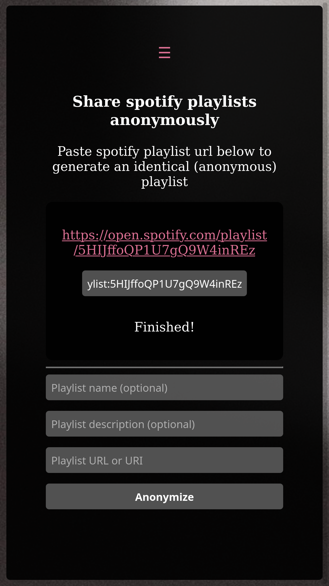
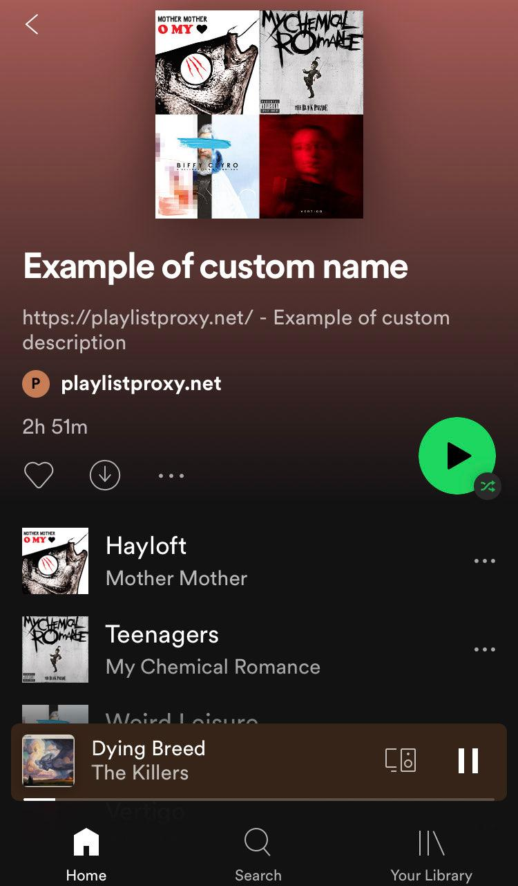

# PlaylistProxy

> [!WARNING]
> **Service Discontinued**
>
> Spotify has restricted their API in a way that sadly leaves PlaylistProxy with no option to continue. The service is no longer functional and the backend/API has been shut down.
>
> Thank you for using my service, I hope I protected the privacy for people who wanted to stay anonymous online.
>
> Due to limited server resources and Spotify's 10k playlist per account limit (which we hit twice) I knew I couldn't handle tons of users, so I never advertised or announced it anywhere when I launched this. Seeing that the service got naturally discovered is something that makes me happy. It definitely made my week when I discovered that [Grindr](https://www.grindr.com/blog/canciones-lgbt) used this service back in 2024.
>
> So long, and thanks for all the fish.

Share your playlists while keeping your identity private.

## Screenshots

### Site on mobile

### Duplicated playlist

